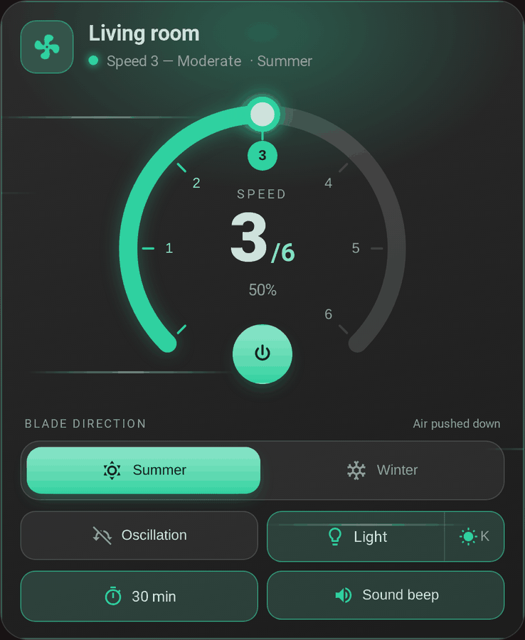
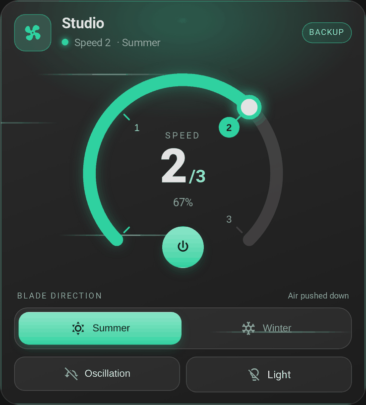
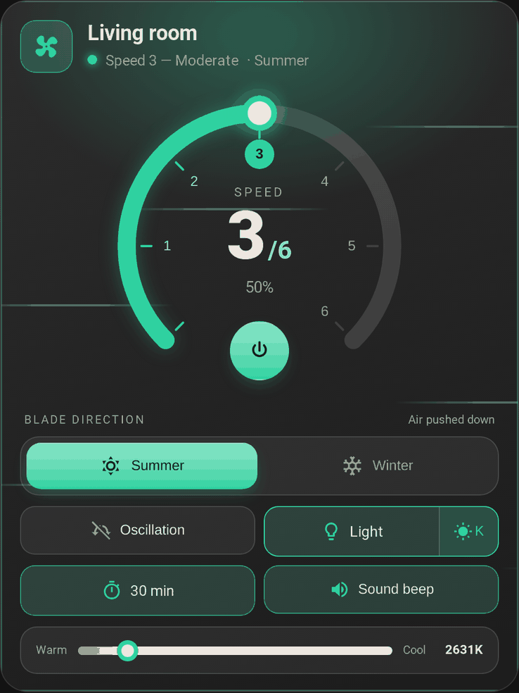

# The card

[← Documentation](../../README.md#documentation) · [Français](../fr/card.md)

A dashboard card to control a ceiling fan, in a dark glass style: a round speed dial, a summer/winter blade direction, and chips for the preset, oscillation, light, stop timer and beep. It ships with the integration and loads by itself: no Lovelace resource to add. It only works with a fan created by the integration: the backup fan, the speeds, the light, the timer and the beep are all set there.

<p align="center">
  
</p>

## Adding the card

**Edit dashboard → Add card → FanBridge**, or in YAML:

```yaml
type: custom:fan-bridge-card
fan_entity: fan.living_room
```

`fan_entity` is the fan created by the integration (`fan.<name>`), and that is enough: the card finds its light, timer and beep by itself, see [Which entities it controls](#which-entities-it-controls). Reload the browser page after installing or updating the integration. A new card is not added to a dashboard by itself: add one per fan.

The visual editor only lists the fans of the FanBridge integration, and only asks for the fan and what belongs to the card (name, direction, light while off). The backup fan, the entities and the speeds are set in the integration, see [Main and backup fans](fans.md).

## What it shows

- **Speed dial**: 270° with one numbered step per speed. Tap the arc or a number to pick a speed. The number of speeds comes from the fan's `percentage_step` (6 when it is not reported); 6-speed fans get named speeds (Gentle, Soft, Moderate, Normal, Strong, Turbo), others "Speed N". A fan with more than 10 steps (continuous speed) gets 6.
- **Power button** in the opening of the dial, shown only if the fan can be turned on and off. An on/off fan without speeds gets no dial.
- **Animated fan icon** that spins faster with speed, and still when the browser asks for reduced motion.
- **Blade direction** (summer / winter) on its own row, independent of power, with a different background effect for each (air streaks / rising particles). It is shown for fans that support `direction`. See [Summer / winter](#summer--winter).
- **Chips** for the preset, oscillation, light, stop timer and beep, each shown only if the fan supports it.
- **Backup badge** while the backup fan is in charge.

  

- Controls that do not apply while the fan is off (light, beep, preset, timer, direction) are disabled. A fan in `unknown` state counts as off and unavailable.
- **Stop timer presets**, always, also for fans whose timer is a free-form `number`.
- **Light colour temperature**, tucked behind a button next to the light chip.

  


Text and surfaces follow the Home Assistant theme, light or dark. The language is detected from Home Assistant (`fr` / `en`).

### Summer / winter

Not every fan spins counter-clockwise for summer. `summer_direction` tells the card which of the fan's two raw directions (`forward` or `reverse`) is summer mode; the card then maps the toggle and calls `fan.set_direction` accordingly.

### Preset mode

If the fan declares `preset_modes`, a preset chip appears. Picking a preset calls `fan.set_preset_mode`; picking a speed hands control back to `fan.set_percentage`. A preset named `normal` (any case) counts as "no active preset": the header shows the speed instead.

### Light

Some kits cut the light together with the fan, so the light chip is disabled while the fan is off. Set `light_independent: true` for a fan whose light works on its own.

## Options

Only `fan_entity` is required.

| Option | Type | Default | Description |
| --- | --- | --- | --- |
| `fan_entity` | string | **required** | The fan created by the FanBridge integration. Any other fan is refused with a message. |
| `name` | string | fan friendly name | Card title. |
| `show_name` | boolean | `true` | Show the card title. |
| `summer_direction` | string | `forward` | Which raw direction (`forward` / `reverse`) is summer mode. |
| `light_independent` | boolean | `false` | Keep the light usable while the fan is off. |

## Theming

Text, surfaces and borders come from the active Home Assistant theme. The accent is green; override it from a theme or with card-mod:

| Variable | Default | Used for |
| --- | --- | --- |
| `--fan-bridge-card-accent` | `#2fd1a0` | Dial, active controls, glow and effects |

## Which entities it controls

The card controls the fan you give it, and finds the light, the stop timer and the beep of **the same FanBridge device** in the entity registry. It does not depend on their names, so renaming an entity does not break the card. A control whose entity does not exist (a fan without a light, or a role left empty in the integration) is hidden.

The timer is the integration's `select.<name>_timer`: the card shows its options and calls `select.select_option`.

If the entity is not a FanBridge fan, the card shows a message asking for one.

## Speed mapping

The number of speeds is `100 / percentage_step`. A 6-speed fan gets named speeds:

| Speed | Percentage | EN label | FR label |
| --- | --- | --- | --- |
| Off | 0 % | Off | Arrêt |
| 1 | 17 % | Gentle | Très doux |
| 2 | 33 % | Soft | Doux |
| 3 | 50 % | Moderate | Modéré |
| 4 | 67 % | Normal | Moyen |
| 5 | 83 % | Strong | Fort |
| 6 | 100 % | Turbo | Turbo |

Other speed counts get numbered labels. Clicking speed *n* sends `floor(n × 100 / speeds)` % to `fan.set_percentage` (16, 33, 50, 66, 83, 100 on 6 speeds), the value the Home Assistant UI sends: it is the upper bound of speed *n* whether the integration rounds, rounds up or uses Home Assistant's ordered speed lists.
