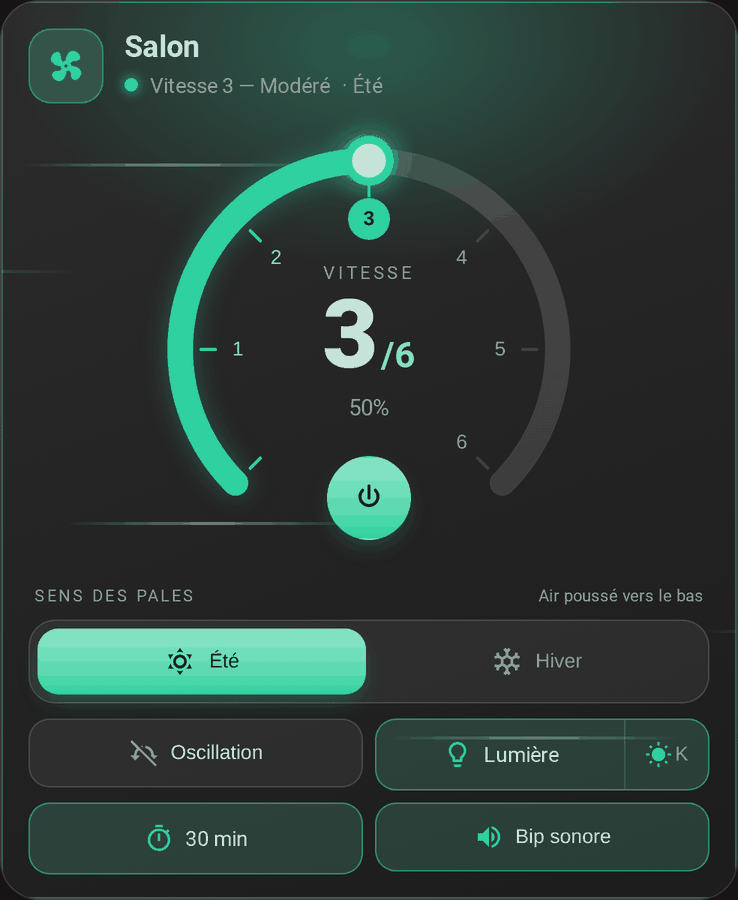
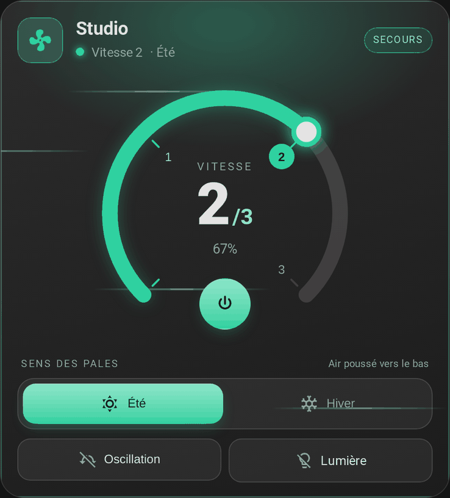
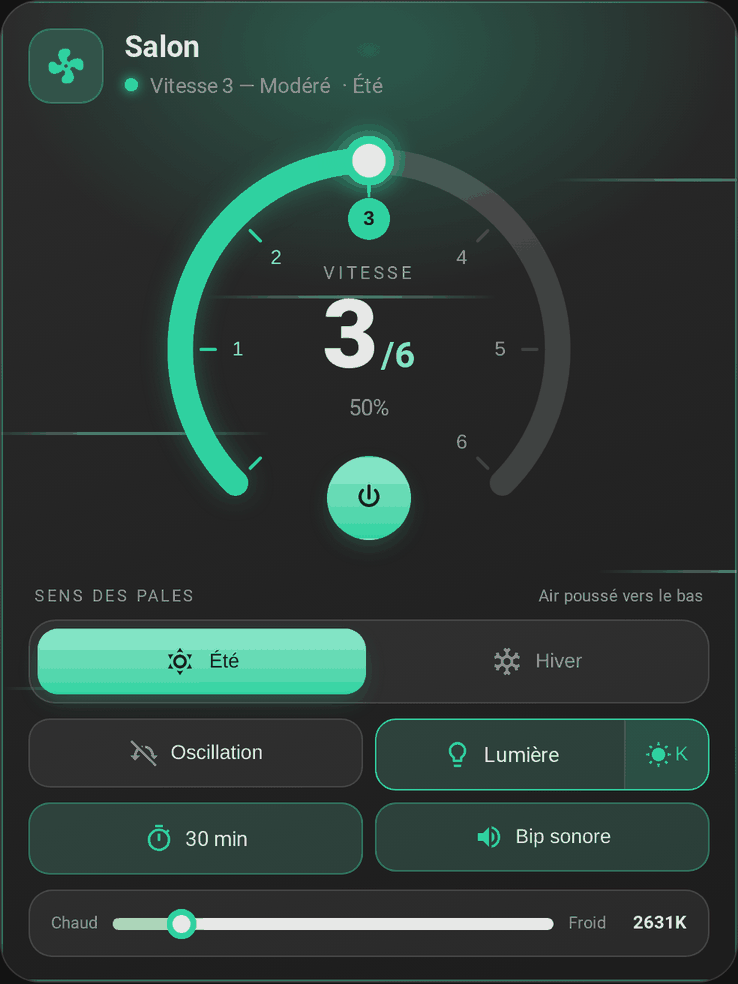

# La carte

[← Documentation](../../README.fr.md#documentation) · [English](../en/card.md)

Une carte de tableau de bord pour commander un ventilateur de plafond, dans un style verre sombre : un cadran rond des vitesses, un sens des pales été/hiver, et des pastilles pour le préréglage, l'oscillation, la lumière, la minuterie d'arrêt et le bip. Elle est livrée avec l'intégration et se charge seule : aucune ressource Lovelace à ajouter. Elle ne fonctionne qu'avec un ventilateur créé par l'intégration : le secours, les vitesses, la lumière, la minuterie et le bip s'y règlent.

<p align="center">
  
</p>

## Ajouter la carte

**Modifier le tableau de bord → Ajouter une carte → FanBridge**, ou en YAML :

```yaml
type: custom:fan-bridge-card
fan_entity: fan.salon
```

`fan_entity` est le ventilateur créé par l'intégration (`fan.<nom>`), et cela suffit : la carte trouve seule sa lumière, sa minuterie et son bip, voir [Les entités qu'elle commande](#les-entités-quelle-commande). Rechargez la page du navigateur après l'installation ou la mise à jour de l'intégration. Une nouvelle carte n'est pas ajoutée seule à un tableau de bord : ajoutez-en une par ventilateur.

L'éditeur visuel ne demande que le ventilateur et ce qui relève de la carte (nom, sens, lumière éteinte). Le secours, les entités et les vitesses se règlent dans l'intégration, voir [Principal et secours](fans.md).

## Ce qu'elle affiche

- **Cadran des vitesses** : 270° avec un pas numéroté par vitesse. Touchez l'arc ou un numéro pour choisir une vitesse. Le nombre de vitesses vient du `percentage_step` du ventilateur (6 s'il n'est pas annoncé) ; les ventilateurs à 6 vitesses ont des vitesses nommées (Très doux, Doux, Modéré, Moyen, Fort, Turbo), les autres « Vitesse N ». Un ventilateur de plus de 10 pas (vitesse continue) en a 6.
- **Bouton marche/arrêt** dans l'ouverture du cadran, affiché seulement si le ventilateur peut être allumé et éteint. Un ventilateur tout ou rien sans vitesses n'a pas de cadran.
- **Icône de ventilateur animée** qui tourne plus vite avec la vitesse, et immobile quand le navigateur demande de réduire les animations.
- **Sens des pales** (été / hiver) sur sa propre ligne, indépendant de la marche, avec un effet de fond différent pour chacun (filets d'air / particules qui montent). Il apparaît pour les ventilateurs qui gèrent `direction`. Voir [Été / hiver](#été--hiver).
- **Pastilles** pour le préréglage, l'oscillation, la lumière, la minuterie d'arrêt et le bip, chacune affichée seulement si le ventilateur la gère.
- **Badge de secours** tant que le ventilateur de secours est en service.

  

- Les commandes qui n'ont pas de sens ventilateur éteint (lumière, bip, préréglage, minuterie, sens) sont désactivées. Un ventilateur à l'état `unknown` compte comme éteint et indisponible.
- **Préréglages de minuterie**, toujours, y compris pour les ventilateurs dont la minuterie est un `number` en saisie libre.
- **Température de couleur de la lumière**, derrière un bouton à côté de la pastille lumière.

  


Le texte et les surfaces suivent le thème de Home Assistant, clair ou sombre. La langue est détectée depuis Home Assistant (`fr` / `en`).

### Été / hiver

Tous les ventilateurs ne tournent pas à gauche en été. `summer_direction` indique à la carte laquelle des deux directions brutes du ventilateur (`forward` ou `reverse`) correspond à l'été ; la carte associe alors la bascule et appelle `fan.set_direction` en conséquence.

### Préréglage

Si le ventilateur déclare des `preset_modes`, une pastille de préréglage apparaît. Choisir un préréglage appelle `fan.set_preset_mode` ; choisir une vitesse rend la main à `fan.set_percentage`. Un préréglage nommé `normal` (quelle que soit la casse) compte comme « aucun préréglage actif » : l'en-tête affiche alors la vitesse.

### Lumière

Certains kits coupent la lumière avec le ventilateur : la pastille lumière est alors désactivée ventilateur éteint. Mettez `light_independent: true` pour un ventilateur dont la lumière fonctionne seule.

## Options

Seul `fan_entity` est obligatoire.

| Option | Type | Défaut | Description |
| --- | --- | --- | --- |
| `fan_entity` | texte | **obligatoire** | Le ventilateur créé par l'intégration FanBridge. Tout autre ventilateur est refusé avec un message. |
| `name` | texte | nom du ventilateur | Titre de la carte. |
| `show_name` | booléen | `true` | Afficher le titre de la carte. |
| `summer_direction` | texte | `forward` | Direction brute (`forward` / `reverse`) qui correspond à l'été. |
| `light_independent` | booléen | `false` | Garder la lumière utilisable ventilateur éteint. |

## Thème

Le texte, les surfaces et les bordures viennent du thème actif de Home Assistant. L'accent est vert ; changez-le depuis un thème ou avec card-mod :

| Variable | Défaut | Sert à |
| --- | --- | --- |
| `--fan-bridge-card-accent` | `#2fd1a0` | Cadran, commandes actives, halo et effets |

## Les entités qu'elle commande

La carte commande le ventilateur indiqué, et retrouve la lumière, la minuterie d'arrêt et le bip **du même appareil FanBridge** dans le registre des entités. Elle ne dépend pas de leurs noms : renommer une entité ne casse donc pas la carte. Une commande dont l'entité n'existe pas (un ventilateur sans lumière, ou un rôle laissé vide dans l'intégration) est masquée.

La minuterie est un `select` ou un `number` selon l'entité d'origine : la carte appelle `select.select_option` ou `number.set_value` en conséquence, et affiche les options que rapporte un `select`.

Si l'entité n'est pas un ventilateur FanBridge, la carte affiche un message qui en demande un.

## Correspondance des vitesses

Le nombre de vitesses vaut `100 / percentage_step`. Un ventilateur à 6 vitesses a des vitesses nommées :

| Vitesse | Pourcentage | Libellé FR | Libellé EN |
| --- | --- | --- | --- |
| Arrêt | 0 % | Arrêt | Off |
| 1 | 17 % | Très doux | Gentle |
| 2 | 33 % | Doux | Soft |
| 3 | 50 % | Modéré | Moderate |
| 4 | 67 % | Moyen | Normal |
| 5 | 83 % | Fort | Strong |
| 6 | 100 % | Turbo | Turbo |

Les autres nombres de vitesses ont des libellés numérotés. Cliquer sur la vitesse *n* envoie `floor(n × 100 / vitesses)` % à `fan.set_percentage` (16, 33, 50, 66, 83, 100 sur 6 vitesses), la valeur qu'envoie l'interface de Home Assistant : c'est la borne haute de la vitesse *n*, que l'intégration arrondisse, arrondisse au-dessus ou utilise les listes de vitesses ordonnées de Home Assistant.
